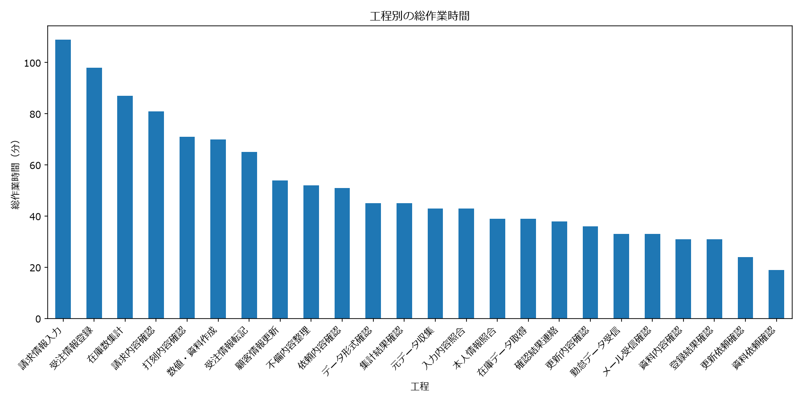
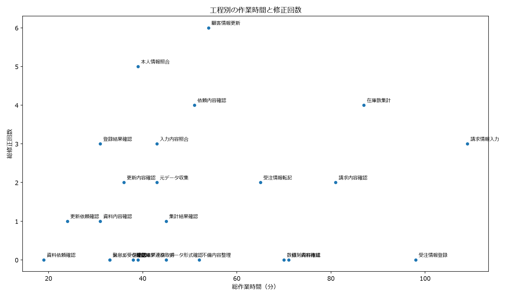

# Business Efficiency Analysis

## 1. プロジェクト概要

業務工程ごとの作業時間と修正回数を分析し、業務効率化・自動化の改善候補を特定することを目的としたデータ分析プロジェクトです。

Pythonのpandasによるデータ集計、matplotlibによる可視化、分析結果に基づく改善提案までを実践しました。

## 2. 分析の目的

業務工程ごとの作業負荷を定量的に把握し、時間削減と修正負荷軽減の観点から、優先的に改善を検討すべき工程を特定します。

## 3. 使用技術

- Python
- pandas
- matplotlib
- Git / GitHub
- Markdown

## 4. 使用データ

練習用に作成した200件の業務データを使用しています。

主な項目：
- 実施日時
- 作業名
- 工程
- 必要ソフトウェア
- 作業時間
- 修正回数

※実際の企業の業務実績ではなく、分析手法を学ぶためのダミーデータです。

## 5. 分析方法

1. データの読み込みと基本的な検証
2. 工程別の発生回数・総作業時間・平均作業時間・総修正回数などの集計
3. 時間負荷スコアと修正負荷スコアの算出
4. 両スコアを統合した自動化候補スコアの算出
5. 棒グラフ・散布図による可視化
6. 分析結果の解釈と業務改善提案

自動化候補スコアは、時間負荷60%、修正負荷40%の重み付けで算出しています。これは本プロジェクト独自の評価基準であり、自動化の実現可能性や実際の削減効果を直接示すものではありません。

## 6. 主な分析結果

- 請求情報入力：総作業時間109分、自動化候補スコア0.800
- 在庫数集計：総作業時間87分、自動化候補スコア0.746
- 顧客情報更新：総修正回数6回、修正負荷スコア1.000

これらの結果から、請求情報入力を時間削減の観点で優先候補とし、在庫数集計や顧客情報更新についても改善の可能性を検討しました。

## 7. 分析結果の可視化

### 工程別の総作業時間



### 工程別の作業時間と修正回数



## 8. 改善提案

請求情報入力を優先候補として、担当者へのヒアリング、作業手順の確認、入力元・入力先システムの連携可能性などを調査します。

その上で、時間削減効果、修正削減効果、導入コスト、セキュリティ、運用負荷を考慮し、自動化の実現可能性を評価します。

## 9. 実行方法

Pythonがインストールされた環境で、プロジェクトのルートフォルダから以下を実行してください。

```bash
python -m pip install pandas matplotlib
python analysis.py
```

グラフ画像は `images/` フォルダに保存されます。実行前に、このフォルダが存在することを確認してください。

## 10. 分析上の制約

- 練習用のダミーデータを使用しており、実際の企業の業務実績を反映したものではありません。
- スコアの順位は重み付けの設定によって変わる可能性があります。
- 作業時間と修正回数だけでは、業務の複雑さや自動化の技術的実現可能性を十分に評価できません。
- 実務への適用には、実データの分析、担当者へのヒアリング、費用対効果の検証が必要です。

## 11. 今後の改善

- 実際の業務データを想定した分析項目の拡張
- スコアの重み付けを変えた場合の比較
- 自動化による削減効果の試算
- 分析結果を活用した業務改善ツールの開発